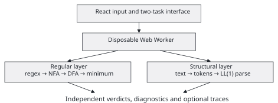
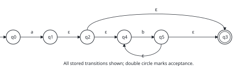
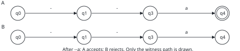
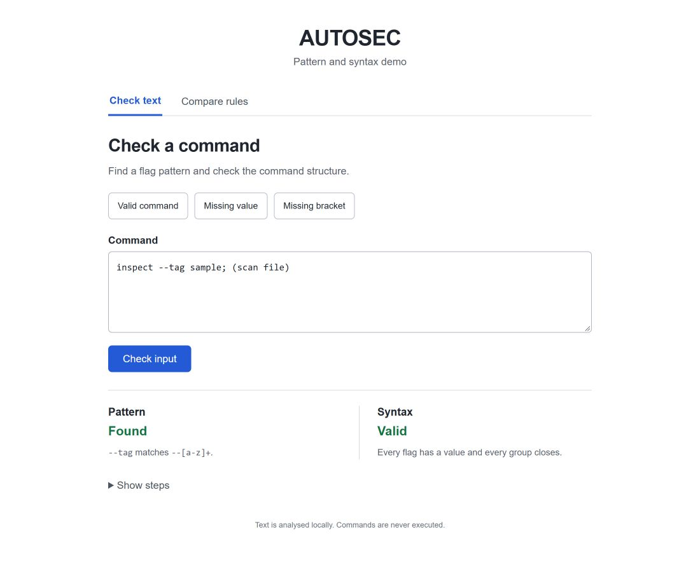
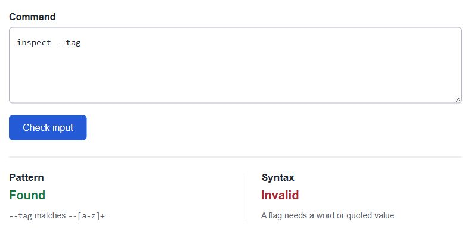
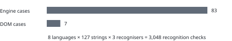
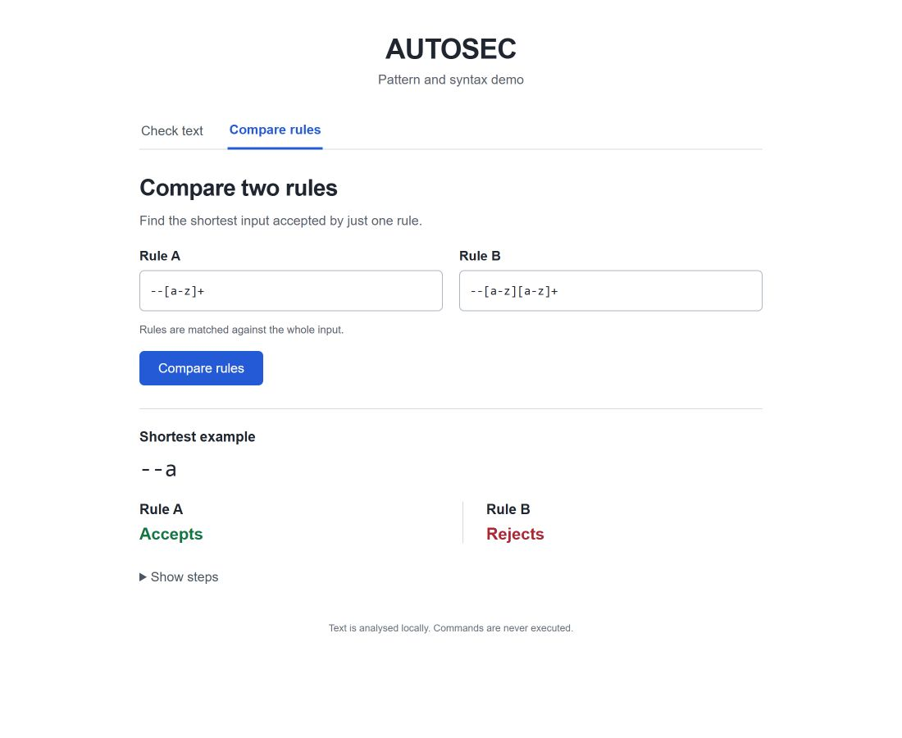

# AUTOSEC

Counterexample-Driven Automata and Syntax Demo

Bhoumik Singh Rajput (25BYB0120); Vihaan Jinesh Jain (25BYB0130)

Faculty: Dr. Dharmendra Singh Rajput. VIT Vellore. BACSE201, 2026–27.

24 October 2026

<!-- pagebreak -->

## Abstract

Pattern occurrence and syntactic validity are distinct properties of an input. AUTOSEC is a browser-local teaching application that evaluates these properties independently and explains differences between regular rules through shortest counterexamples. A TypeScript engine parses supported regular expressions, constructs Thompson ε-nondeterministic finite automata, computes ε-closures, performs subset construction, and minimises the resulting deterministic machines. A second pipeline tokenises a restricted nested command language and performs predictive parsing using computed FIRST/FOLLOW sets and an LL(1) table. Breadth-first search over a product automaton returns either language equivalence or a shortest string accepted by exactly one rule. The interface presents two tasks, Check text and Compare rules, with optional execution traces. Verification on 24 October 2026 recorded 90 passing automated tests and a successful production build. Eight independently specified languages were evaluated on all 127 binary strings of length at most six. Genuine application screenshots illustrate valid nested syntax, a missing flag value, and the distinguishing string `--a`. The contribution is the integration of independent pattern and syntax verdicts with a reproducible counterexample workflow. The evaluation establishes observed implementation behaviour; educational effectiveness remains a question for a future user study.

**Index Terms:** formal languages, finite automata, regular expressions, predictive parsing, context-free grammar, shortest counterexample, educational software.

### Report organisation

- I. Introduction and Related Work: p. 3
- II. Formal Definitions and Recognition Semantics: p. 4
- III. Methodology and System Architecture: p. 5
- IV. Regular-Language Construction: p. 6
- V. Lexical Analysis and Predictive Parsing: p. 7
- VI. Shortest-Counterexample Method: p. 8
- VII. Actual Application Screenshots: p. 9
- VIII. Evaluation and Observed Results: p. 10
- IX. Discussion, Limitations and Conclusion: p. 11
- References: p. 12

### Project scope

The application connects three course topics through one command-like example: regular-language recognition, nested syntax, and language comparison. Users inspect a result, make a small change, and examine why acceptance changes. Inputs are analysed as text. The interface concentrates on these tasks, while this report supplies the definitions, diagrams and methodology. Reference [1] provides the formal-language and automata background.

<!-- pagebreak -->

## I. Introduction and Related Work

### A. Problem statement

The strings `inspect --tag sample` and `inspect --tag` both contain a flag-shaped substring. Only the first supplies the value required by the project grammar. This example motivates two separate questions: does a pattern occur, and is the complete input syntactically valid? Nested command groups introduce a further requirement: the parser must retain the expected closing delimiters. AUTOSEC makes these decisions visible, then allows users to compare two regular rules through a shortest distinguishing input.

Recent educational work explains regex-to-automaton transformations [2], nondeterministic rejection [3], and machine/stack behaviour [4]. Recipe-based diagnostics support regex development [5]. These studies motivate explicit intermediate representations and concise explanations. Table I compares their documented emphasis with AUTOSEC's design. It is a qualitative comparison of the cited work, rather than a benchmark of the systems.

TABLE I. DOCUMENTED EMPHASIS AND AUTOSEC DESIGN POSITION

| Work | Documented emphasis | AUTOSEC emphasis |
| --- | --- | --- |
| FSM visualisation [2]–[4] | Transformations, computation graphs and machine/stack execution. | A command with two verdicts, then a shortest rule disagreement. |
| Recipe support [5] | Regex design process and targeted diagnostic feedback. | A small set of prepared contrasts and optional computed steps. |
| automata [6] | Python API, simulation, conversion, language operations and equivalence. | Direct browser forms without coding an automata API. |
| AALpy [7] | Active model learning, testing and equivalence oracles. | Exact product search between two supplied regex-derived DFAs. |

### B. Distinction and objectives

AUTOSEC combines **two independent verdicts on the same command** with **a shortest witness between two explicit rules** in a two-task interface. Its distinction is this focused teaching workflow: inspect a command, identify a syntax failure, change a rule, and explain the resulting disagreement. The automata library provides established transformations and language operations [6]; AALpy uses counterexamples in model learning [7]. AUTOSEC applies established algorithms to a fixed nested command language, with its contribution located in their integration and presentation.

The implementation objectives are to compute verdicts from explicit machines, preserve token offsets, identify the first syntax failure, and reproduce each rule disagreement with synchronised traces. Evaluation checks these behaviours against independent predicates and recorded examples. Comparative accuracy, usability and speed require a separate study.

<!-- pagebreak -->

## II. Formal Definitions and Recognition Semantics

### A. Symbols, languages and finite-state machines

An **alphabet** Σ is a finite set of symbols. A **string** w is a finite sequence over Σ; ε denotes the empty string and |w| its length. A **language** is a set of strings, L ⊆ Σ*. A regular expression denotes a language through literals, concatenation, union and repetition. In the supported syntax, `r*` denotes zero or more repetitions of r, `r+` denotes one or more, and `r?` denotes zero or one.

A **DFA** is M = (Q, Σ, δ, q₀, F), where Q is a finite state set, δ: Q × Σ → Q is the transition function, q₀ ∈ Q is the initial state, and F ⊆ Q is the accepting set. Its extended transition δ* consumes a string. An **ε-NFA** permits multiple successor states and transitions that consume no character. Its active configuration is a set of states. **ε-closure(S)** includes S and every state reachable from S using only ε-transitions.

L(M) = {w ∈ Σ* | δ*(q₀, w) ∈ F}                 (1)

ε-closure(S) = {q | ∃s ∈ S, s →ε* q}           (2)

### B. Syntax and distinguishing inputs

A **CFG** is G = (V, T, P, S), with nonterminals V, terminals T, productions P, and start symbol S. A **token** records a lexical category, source text and interval [start, end). An **LL(1) parser** selects a production using its stack top and one lookahead token. A **PDA** adds a stack to finite control. AUTOSEC demonstrates this memory through its predictive parser: pending grammar symbols remain on the stack until matched or expanded.

TABLE II. NOTATION USED THROUGHOUT THE REPORT

| Symbol | Meaning |
| --- | --- |
| Σ* | All finite strings over Σ, including ε. |
| L(r), L(G) | Languages denoted by a regex and generated by the grammar. |
| δ*(q, w) | State reached after consuming w from state q. |
| A △ B | Symmetric difference: strings in exactly one language. |
| [s, e) | Start included; end excluded. Source offsets are zero-based. |
| $ | End-of-input marker, not a character in the command. |

Pattern search asks whether a substring belongs to L(r). Syntax asks whether the complete token sequence belongs to L(G). Rule comparison uses whole-string membership in both regex languages. A **distinguishing string** lies in their symmetric difference. A shortest witness minimises length; it need not be unique. Raw matching may find `--tag` inside `inspect "--tag"`, while the lexer correctly treats the quoted text as one value.

<!-- pagebreak -->

## III. Methodology and System Architecture

### A. Design and verification procedure

The methodology has four stages: specify the language and recognition semantics; implement explicit automata and parser representations; integrate the two analysis paths; and verify the resulting behaviour. Verification combines independent language predicates, exact product checks, malformed-input cases, and inspection of the running interface. The unit of evaluation is a reproducible input or rule pair. Programming-oriented automata activities provide related educational context [8]; the present evaluation concerns the software artefact.



### B. Computation protocol

React manages input and result state; Vite builds the TypeScript application. Submitting a form creates a disposable module Web Worker and sends `{id, task, data}`. The dispatcher calls `analyse()` or compiles both rules before invoking `compareDfa()`. The worker returns serialisable machines, tokens, traces and diagnostics for rendering. Editing clears the previous result, and switching views disposes of pending computation. This separation keeps the algorithm engine independent of the interface.

TABLE III. METHODOLOGY AND CORRESPONDING ARTEFACT

| Stage | Concrete procedure | Evidence |
| --- | --- | --- |
| Specification | Fix regex subset, token categories and nested grammar. | Definitions and productions. |
| Construction | Generate automata and predictive decisions from inputs. | Machine edges, sets and traces. |
| Verification | Use independent predicates and exact comparisons. | 90 tests and worker fixtures. |
| Presentation | Exercise examples and capture real rendered results. | Cursor-free browser captures. |

### C. Resource and operational boundaries

The engine admits 98 ASCII symbols, at most 128 regex characters, 2,048 input characters, 256 NFA states and 512 DFA states. A request exceeding 12 seconds is terminated. Cancellation or resource exhaustion produces **analysis incomplete**, not rejection or equivalence. Ordinary use of the installed local build requires no external service. Inputs are not sent to a backend, executed as commands, or used to visit entered URLs. Unsupported regex constructs are diagnosed rather than approximated silently.

<!-- pagebreak -->

## IV. Regular-Language Construction

### A. Parsing and Thompson construction

`parseRegex()` builds an abstract syntax tree with alternation, concatenation and repetition precedence. `thompson()` recursively constructs entry/exit fragments. Literal fragments add labelled edges; concatenation connects fragments by ε; alternation introduces ε-branches; repetition adds the required skip or loop. Character classes such as `[a-z]` expand into supported symbols. Backreferences, lookarounds, anchors and counted repetitions are rejected by this subset.


### B. Worked construction for ab*

The expression `ab*` denotes an `a` followed by zero or more `b` symbols. Figure 2 uses the state IDs and edges recorded by the engine. After reading `a`, ε-closure reaches {1,2,3,4}, including accepting NFA state 3; therefore `a` is accepted. Subset construction records each reachable closed set as a DFA state. The empty subset represents a rejecting sink when reachable, as shown in Table IV.



TABLE IV. REACHABLE DFA SUBSETS FOR ab*

| DFA state | Represented NFA set | Accepting? |
| --- | --- | --- |
| q0 | {0} | No |
| q1 | {1,2,3,4} | Yes |
| q2 | {} | No |
| q3 | {3,4,5} | Yes |

### C. Minimisation and implementation limits

Partition refinement separates accepting from rejecting states, repeatedly splitting blocks with distinguishable transitions. For this fixture, DFA states 1 and 3 merge: both accept and have the same future language. The measured sequence is **6 NFA → 4 DFA → 3 minimal-DFA states**. The implementation uses a Hopcroft-style worklist with straightforward set scans; it does not claim the optimised textbook running-time bound. Extended derivative-based regex matching supports constructs intentionally outside this demo [9]. Such research is a scope comparison, not a component dependency or a reason to claim full regex compatibility.

<!-- pagebreak -->

## V. Lexical Analysis and Predictive Parsing

### A. Fixed nested command language

The lexer recognises WORD, lowercase FLAG, double-quoted QUOTED values, `;`, `(` and `)`. Quoted values permit escaped quotes and backslashes. Adjacent words, flags and quoted values require whitespace. A flag always requires a value. Tokens preserve source offsets so that a failure can be related to the original text. Lexing and parsing remain separate: if lexing fails, the parser does not accept a partial stream.

```text
Script    → Statement Rest
Rest      → ; Statement Rest | ε
Statement → WORD Args | ( Script )
Args      → Arg Args | ε
Arg       → FLAG Value | Value
Value     → WORD | QUOTED
```

### B. Calculated decisions

FIRST(A) contains terminals that can begin strings derived from A, with ε when A is nullable. FOLLOW(A) contains terminals that can immediately follow A; `$` marks end-of-input. `grammarInfo()` calculates these sets to a fixed point, fills the predictive table and detects duplicate assignments. The current grammar yields no table conflicts. The empty production is stored as an empty array, rather than an input character.

TABLE V. FIRST/FOLLOW SETS COMPUTED FROM THE FIXED GRAMMAR

| Nonterminal | FIRST | FOLLOW |
| --- | --- | --- |
| Script | {(, WORD} | {$, )} |
| Rest | {;, ε} | {$, )} |
| Statement | {(, WORD} | {$, ), ;} |
| Args | {FLAG, QUOTED, WORD, ε} | {$, ), ;} |
| Arg | {FLAG, QUOTED, WORD} | {$, ), ;, FLAG, QUOTED, WORD} |
| Value | {QUOTED, WORD} | {$, ), ;, FLAG, QUOTED, WORD} |

### C. Dry run and stack interpretation

For `inspect --tag sample; (scan file)`, the worker records **8 tokens and 25 parser actions**. The stack begins with Script over `$`. Expansions push right-hand sides in reverse order, making the leftmost symbol the next one processed. An opening group leaves a closing `)` pending until its inner Script finishes.

TABLE VI. FIRST FOUR ACTIONS FOR THE VALID COMMAND

| Step | Stack top first | Applied action |
| --- | --- | --- |
| 1 | Script $ | Script → Statement Rest |
| 2 | Statement Rest $ | Statement → WORD Args |
| 3 | WORD Args Rest $ | Match WORD: "inspect" |
| 4 | Args Rest $ | Args → Arg Args |

For `inspect --tag`, Value remains pending at end-of-input (offset 13), although the pattern still matches. Removing the final `)` from the valid example leaves a closing delimiter pending at offset 32. These zero-based offsets identify the first failure in each input. POSIX lexing [10] and verified lexer work [11] address stronger proof obligations; the present implementation is tested rather than mechanically verified.

<!-- pagebreak -->

## VI. Shortest-Counterexample Method

### A. Product construction

Let A and B be generated DFAs. Each product node is a pair (p, q). A symbol advances both components; an undefined transition enters an implicit rejecting sink. A node distinguishes the languages exactly when one component accepts and the other rejects. The search uses the union of both alphabets and visits each reachable pair once.

L(A) △ L(B) = (L(A) − L(B)) ∪ (L(B) − L(A))     (3)

|w*| = min {|w| : w ∈ L(A) △ L(B)}            (4)

```text
queue ← [(startA, startB)]
for each pair in queue, in discovery order:
    if acceptingA(pair.left) XOR acceptingB(pair.right):
        return the input reconstructed through parent links
    for each symbol in the shared alphabet:
        enqueue the successor pair if it has not been seen
return equivalent
```

### B. Shortestness argument and observed witness

Every product edge consumes one character, so breadth-first traversal processes nondecreasing input lengths. The first acceptance-disagreeing node therefore has a shortest path from the initial pair. Keeping one shortest predecessor per pair is sufficient because future acceptance depends on the pair, not its earlier path. If the complete reachable product is exhausted without disagreement, the symmetric difference is empty. Interruption is reported as incomplete.



TABLE VII. COMPUTED ACCEPTANCE ALONG THE SHORTEST WITNESS

| Prefix | A state / acceptance | B state / acceptance |
| --- | --- | --- |
| ε | q0 / reject | q0 / reject |
| - | q1 / reject | q1 / reject |
| -- | q3 / reject | q3 / reject |
| --a | q4 / accept | q4 / reject |

The default A = `--[a-z]+` accepts two hyphens followed by at least one lowercase letter; B = `--[a-z][a-z]+` requires at least two letters. The observed witness is `--a`, found after **5 processed pairs**. Every shorter string is rejected by both rules. State labels are local to each machine, so equal numbers can have different acceptance values. For m and n completed DFA states and alphabet size k, product search uses O(kmn) time and O(mn) storage, excluding compilation. This exact comparison differs from AALpy's learning/oracle workflow [7].

<!-- pagebreak -->

## VII. Actual Application Screenshots

The application screenshots were captured on 24 October 2026 at `http://127.0.0.1:4173/` using an 1100 × 900 desktop viewport. Figure 4 shows the valid nested example; Figure 5 isolates the missing-value diagnostic. Full captures accompany the repository, and Figure 5 is a directly captured viewport excerpt. Results are unaltered; images are resized only for placement.





Together, the captures show that finding `--tag` and accepting the complete command are separate decisions. Deleting its value changes the syntax verdict while preserving the pattern match. This small edit provides a direct demonstration of the distinction.

<!-- pagebreak -->

## VIII. Evaluation and Observed Results

### A. Verification protocol

The suite separates engine tests from DOM interaction tests. Eight independent language predicates are evaluated on every string over {a,b} of length 0 through 6: 1 + 2 + 4 + 8 + 16 + 32 + 64 = 127 strings per language. Each expected answer is compared against NFA, DFA and minimal-DFA simulation, producing **3,048 recognition checks** within those parameterised test cases. Exact product checks additionally compare language preservation; finite enumeration alone is not treated as a proof for arbitrary strings.



TABLE VIII. OBSERVED VERIFICATION RESULTS, 24 OCTOBER 2026

| Check | Observed result | Interpretation |
| --- | --- | --- |
| Engine / DOM suite | 83 / 7 passing | 90 test cases; not 90 user participants. |
| Production build | Passed | TypeScript and Vite build successful. |
| ab* construction | 6 → 4 → 3 states | NFA, DFA and minimal DFA. |
| Default comparison | --a; 5 processed pairs | A accepts and B rejects. |
| a+ versus aa* | Equivalent | Reachable product exhausted. |
| a* versus a+ | Empty witness ε | Initial acceptance disagrees. |

### B. Behavioural cases and evidence provenance

TABLE IX. TWO INDEPENDENT OUTCOMES ON THE SAME INPUT

| Input | Flag found? | Syntax accepted? |
| --- | --- | --- |
| inspect --tag sample; (scan file) | Yes | Yes |
| inspect --tag | Yes | No |
| inspect file | No | Yes |
| (inspect file | No | No |
| inspect "--tag" | Yes | Yes |

The 24 October browser session reproduced valid and missing-value results, the default witness and trace, and missing-bracket behaviour at 390px. No console warnings/errors were observed; the mobile document width equalled its 390px viewport. The 23 October real-browser review separately verified cancellation, equivalence, an empty witness and invalid-regex diagnostics. DOM cancellation tests also passed in the current run. Node worker fixtures verify the built asset and serialisation; they are not browser timing benchmarks. No threat-detection accuracy, learning-gain percentage or performance superiority was measured.

<!-- pagebreak -->

## IX. Discussion, Limitations and Conclusion

### A. Interpretation and contribution

The demonstration connects three observations: a pattern may occur in invalid syntax; a stack tracks nested groups; and a shortest witness explains a rule difference. The non-nested command subset can be regular. The grammar's unrestricted nesting motivates stack memory, while the implementation enforces finite resource bounds. AUTOSEC contributes this compact explanatory workflow alongside the broader libraries [6], [7] and visualisation systems [2]-[4].



### B. Threats to validity and future evaluation

The examples are selected demonstrations, so their outcomes do not establish general usability. ASCII and state bounds limit coverage; token and regex semantics are narrower than production shells and regex dialects. Some tests share implementation infrastructure. Independent predicates and exact product checks provide complementary checks. Browser observations cover one browser and two viewport sizes. Labels and keyboard controls support inspection, while comprehensive WCAG 2.2 [12] compliance remains unassessed.

A future controlled study could compare unaided and tool-assisted explanations of pattern/syntax disagreement, measuring witness reasoning, task time and error rates. Educational activity design [8] and concise diagnostics [5] provide starting points. Such evidence would test whether the focused interface improves understanding without expanding the present demonstration.

### C. Conclusion

AUTOSEC integrates automata construction, predictive parsing and exact product search in a small browser application. Recorded tests, worked traces and genuine screenshots support the reported behaviour. Its practical contribution is a reproducible route from an input or rule change to an explicit explanation. Educational effectiveness and comparative performance remain open evaluation questions.

<!-- pagebreak -->

## References

[1] P. Linz and S. H. Rodger, "An Introduction to Formal Languages and Automata," 7th ed. Burlington, MA, USA: Jones & Bartlett Learning, ISBN 9781284231601, 2023. https://www.jflap.org/linzbook7/

[2] M. T. Morazán and T. Minić, "Finite-State Automaton To/From Regular Expression Visualization," Electronic Proceedings in Theoretical Computer Science, vol. 405, pp. 36–55, 2024. doi: 10.4204/EPTCS.405.3. https://arxiv.org/abs/2407.08088

[3] O. Kempinski and M. T. Morazán, "Visualizing Why Nondeterministic Finite-State Automata Reject," arXiv preprint arXiv:2310.08025, presented at the Scheme and Functional Programming Workshop, 2023. doi: 10.48550/arXiv.2310.08025. https://arxiv.org/abs/2310.08025

[4] M. T. Morazán, D. A. K. Fields, A. M. Garced, and T. Minić, "Visual Execution and Validation of Finite-State Machines and Pushdown Automata," Electronic Proceedings in Theoretical Computer Science, vol. 424, pp. 87–108, 2025. doi: 10.4204/EPTCS.424.5. https://arxiv.org/abs/2508.03641

[5] M. T. Morazán et al., "A Design Recipe and Recipe-Based Errors for Regular Expressions," Electronic Proceedings in Theoretical Computer Science, vol. 424, pp. 25–48, 2025. doi: 10.4204/EPTCS.424.2. https://arxiv.org/abs/2508.03639

[6] C. Evans and E. W. Robson, "automata: A Python package for simulating and manipulating automata," Journal of Open Source Software, vol. 8, no. 90, Art. no. 5759, 2023. doi: 10.21105/joss.05759. https://joss.theoj.org/papers/10.21105/joss.05759

[7] E. Muškardin, B. K. Aichernig, I. Pill, A. Pferscher, and M. Tappler, "AALpy: An active automata learning library," Innovations in Systems and Software Engineering, vol. 18, no. 3, pp. 417–426, 2022. doi: 10.1007/s11334-022-00449-3. https://link.springer.com/article/10.1007/s11334-022-00449-3

[8] J. Dochkova-Todorova and I. Donchev, "STEM Approach to Build Competences from Automata and Languages Theory," Science Series Innovative STEM Education, vol. 6, pp. 35–54, 2024. doi: 10.55630/STEM.2024.0604. https://doi.org/10.55630/STEM.2024.0604

[9] I. E. Varatalu, M. Veanes, and J.-P. Ernits, "Derivative Based Extended Regular Expression Matching Supporting Intersection, Complement and Lookarounds," arXiv preprint arXiv:2309.14401, , 2023. doi: 10.48550/arXiv.2309.14401. https://arxiv.org/abs/2309.14401

[10] C. Tan and C. Urban, "POSIX Lexing with Bitcoded Derivatives," Proc. 14th Int. Conf. Interactive Theorem Proving (LIPIcs), vol. 268, pp. 27:1–27:18, 2023. doi: 10.4230/LIPIcs.ITP.2023.27. https://drops.dagstuhl.de/entities/document/10.4230/LIPIcs.ITP.2023.27

[11] D. Egolf, S. Lasser, and K. Fisher, "Verbatim++: Verified, Optimized, and Semantically Rich Lexing with Derivatives," Proc. 11th ACM SIGPLAN Int. Conf. Certified Programs and Proofs, pp. 27–39, 2022. doi: 10.1145/3497775.3503694. https://www.egolf.io/

[12] World Wide Web Consortium, "Web Content Accessibility Guidelines (WCAG) 2.2," W3C Recommendation, Oct. 5, 2023. https://www.w3.org/TR/2023/REC-WCAG22-20231005/
